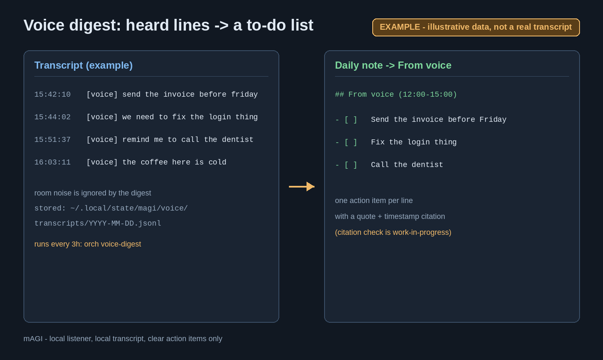

# An always-on local voice listener that turns what you said into a to-do list

*Example (illustrative data, not a real transcript).*

[mAGI](https://github.com/pankajgarkoti/magi) makes Linux a workstation for agents (Omarchy makes it beautiful for humans; different category). It's run from one agent in tmux — you can type to it or talk to it. This post is about the talking part, and what happens to everything you say that isn't a command.

## The listener

`magi-listen` reads the microphone continuously and transcribes with faster-whisper (`base.en`) on the CPU. There's no wake word. Segments with a high no-speech probability or low confidence are dropped. The rest are typed into the orchestrator as `[voice] …` and written, one JSON line per utterance with a timestamp, to `~/.local/state/magi/voice/transcripts/YYYY-MM-DD.jsonl`. Replies are spoken with Piper. Both models ship in the image, so it works offline and no audio leaves the machine. SUPER+SHIFT+M mutes it.

## The digest

People say "remind me to…" or "we need to fix the login thing" while doing something else, and it's gone by evening. So every three hours `voice-digest.timer` runs `orch voice-digest`:

1. Take the transcript lines since the last digest.
2. Ask the configured agent, non-interactively, for clear action items only, one per line as `- [ ] …`, ignoring room noise, chatter and anything already done, or `NONE`.
3. Insert them into today's daily note under `# Tasks` as `## From voice (12:00–15:00)`, and commit the notes repo.
4. If no agent is available, the raw lines go under `## Heard (…)` instead, so nothing is lost.

It's silent when nothing was heard.

## Making it not invent things

The weak point is the summary. A model asked for action items from noisy transcripts will sometimes produce a plausible task nobody asked for. On my own machine the digest now requires a citation on every item: a verbatim quote of 3–25 words with its timestamp, like `⟪15:42:10 "send the invoice before friday"⟫`. A checker normalises case and punctuation and confirms each quote appears in the transcript (ideally in the utterance at that timestamp). Items whose quotes don't match are deleted automatically. This version isn't in mAGI yet; the shipped digest uses the plain prompt above.

## Privacy

Everything stays local: audio, transcripts and the note. The only thing that leaves the machine is the transcript text sent to the agent you chose for the summary (Claude Code, opencode, Codex or a local model through a custom command). With no agent configured, nothing leaves.

Code: [`agent/lib/listen.py`](https://github.com/pankajgarkoti/magi/blob/main/agent/lib/listen.py), the digest in [`agent/bin/orch`](https://github.com/pankajgarkoti/magi/blob/main/agent/bin/orch). MIT licensed.

Earlier parts: [event bus](https://dev.to/pankajgarkoti/an-event-bus-for-a-terminal-coding-agent-deliver-only-when-its-idle-798), persistence (link), guard (link).
